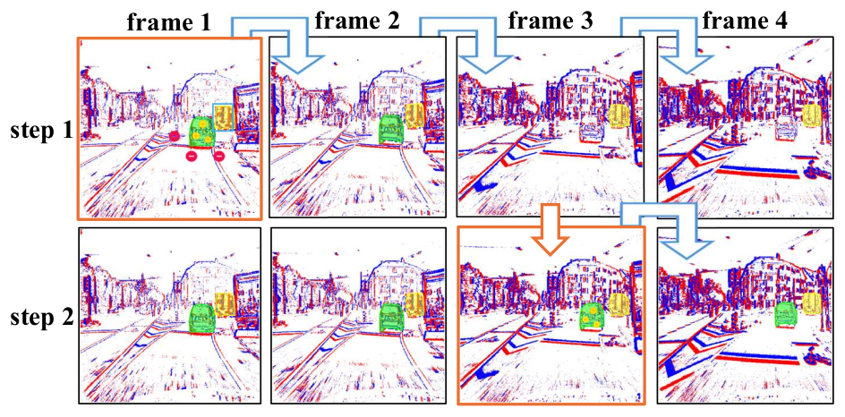
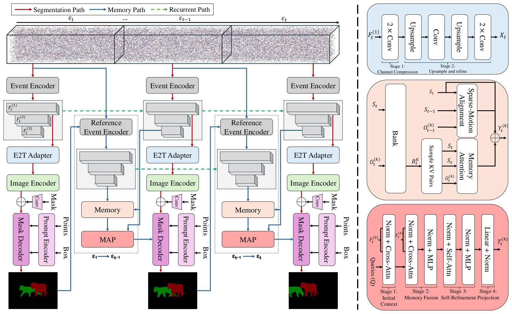

# E-MAPS: Event-Based Promptable Video Segmentation with Memory-as-Prompt

**WACV 2027**

Adonay Demewez Gebremedhin, Mohamad Alansari, Wessam Shehieb, Muzammal Naseer, Hasan AlMarzouqi, Sajid Javed, Naoufel Werghi

## Summary

We study the task of event-based promptable video segmentation via knowledge transfer learning. We show event streams particularly benefit from prompting as they often get sparse and intermittent during low motion scenarios. We build Event Memory-as-Prompt Segmentation (E-MAPS), which learns RGB priors and models object memory as sparse prompts used by a segmentation decoder efficiently. To support this task and model we build the EViM dataset with a carefully designed semi-automatic annotation pipeline.

## Task

## Method

## TODO

- [x] Release dataset
- [ ] Release model code
- [ ] Release model checkpoint

## EViM Dataset

### Download Annotations

- [EViM N-ImageNet](https://drive.google.com/file/d/1rfcVka5SZFMUVPUUcXjvZxCAPGyR4Hzj/view?usp=sharing)
- [EViM DSEC](https://drive.google.com/file/d/1P_u8-fHmuUS6GKgizlK8--NeCkz9gAW3/view?usp=drive_link)

### Source Datasets

EViM is built upon the following publicly available datasets:

- [N-ImageNet](https://github.com/82magnolia/n_imagenet)
- [DSEC-Detection](https://github.com/uzh-rpg/dsec-det)

